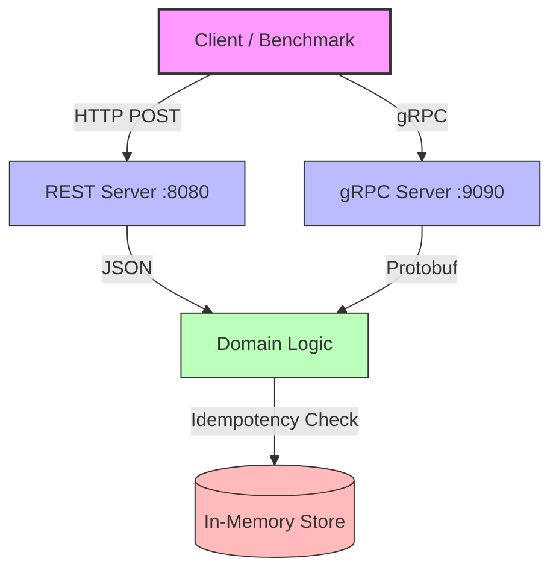
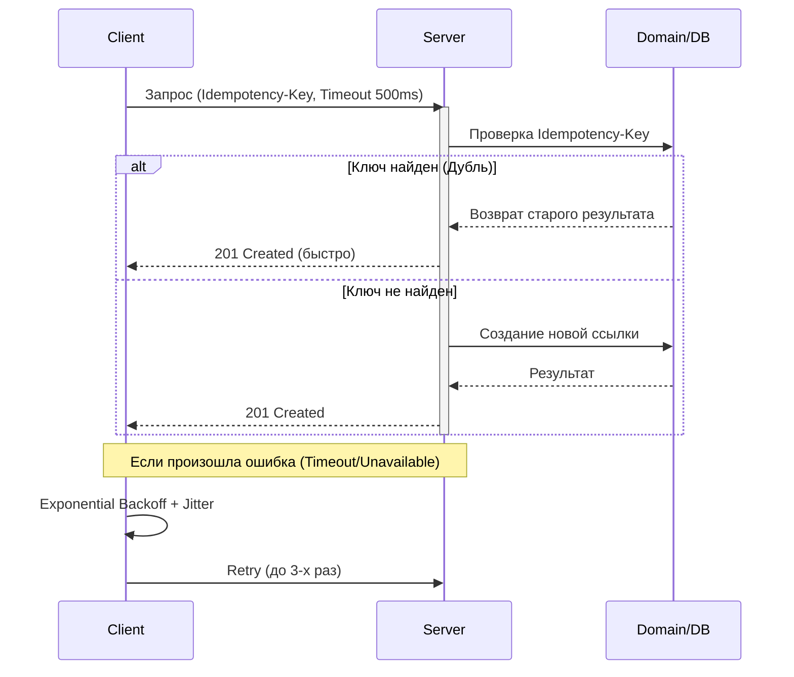

Ошибка возникает из-за того, что в блоке `style` в конце строки случайно оказался символ `ч` (кириллица) или другой скрытый символ, который сломал парсер Mermaid.

Вот **исправленный код** для README. Просто скопируй его заново — здесь я почистил `style` от лишних символов и упростил синтаксис, чтобы GitHub 100% отрендерил.

```markdown
# sis2-protocol

Сравнение gRPC (HTTP/2 + Protobuf) и REST (HTTP/1.1 + JSON) для внутреннего API сервиса коротких ссылок. 
Цель проекта — измерить разницу в latency (p50/p95/p99) и размере payload, а также продемонстрировать реализацию идемпотентности, таймаутов и ретраев.

## 🏗 Архитектура

Проект состоит из двух независимых серверов (REST и gRPC), которые используют общую бизнес-логику (`internal/domain`).



## 🔄 Флоу запроса (с Idempotency, Timeout и Retry)

Диаграмма ниже показывает, как клиент обрабатывает запрос, включая проверку идемпотентности, таймаут и логику повторных попыток при ошибках.



## 🚀 Getting Started

Перед первым запуском необходимо сгенерировать gRPC-код и скачать зависимости:

```bash
# 1. Установить protoc и плагины (macOS)
brew install protobuf
go install google.golang.org/protobuf/cmd/protoc-gen-go@latest
go install google.golang.org/grpc/cmd/protoc-gen-go-grpc@latest

# 2. Сгенерировать gRPC код
make proto

# 3. Скачать зависимости
go mod tidy

# 4. Запустить gRPC сервер (терминал 1)
make run-grpc

# 5. Запустить REST сервер (терминал 2)
make run-rest

# 6. Прогнать бенчмарки (терминал 3)
make bench
```

## ✨ Features

### Сравнение протоколов
Один и тот же эндпоинт `CreateShortUrl` реализован дважды: REST/JSON и gRPC/Protobuf. Бенчмарки замеряют payload size и latency (p50/p95/p99).

Результаты на MacBook Pro M1 Pro:
- **Payload:** JSON 272 B → Protobuf 96 B (**2.8× меньше**)
- **Parse time:** JSON 351 ns → Protobuf 75.9 ns (**4.6× быстрее**)
- **p99 latency (gRPC):** 173 μs

### Idempotency
Клиент генерирует `Idempotency-Key` один раз на логическую операцию. Повторный запрос с тем же ключом возвращает тот же `short_code` — дубль не создаётся.

### Timeouts & Retries
- Таймаут: 500 ms (2× p99 healthy latency), через `context.WithTimeout`.
- Ретраи: max 3 попытки, exponential backoff (100 → 200 → 400 ms) с full jitter.
- Ретраются только transient-ошибки: `Unavailable`, `DeadlineExceeded`, `ResourceExhausted`.

## 📁 Структура проекта

```text
sis2-protocol/
├── cmd/           # Точки входа (rest, grpc)
├── internal/
│   ├── domain/    # Бизнес-логика (не зависит от транспорта)
│   ├── grpcsvc/   # gRPC сервер + клиент с retry
│   └── restsvc/   # REST сервер + клиент
├── proto/         # Контракт .proto
├── benchmark/     # Бенчмарки payload и latency
└── gen/           # Сгенерированный код (не коммитится, в .gitignore)
```
